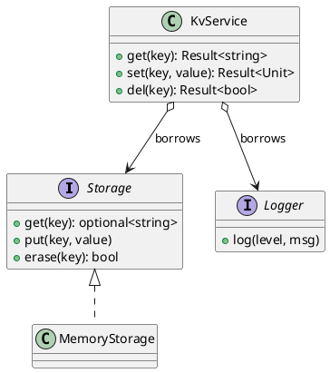
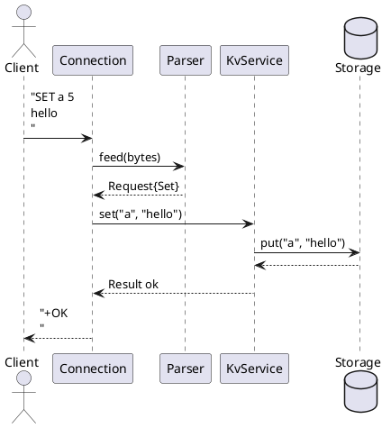
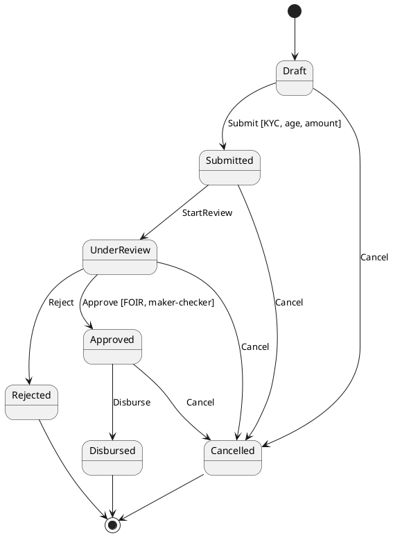
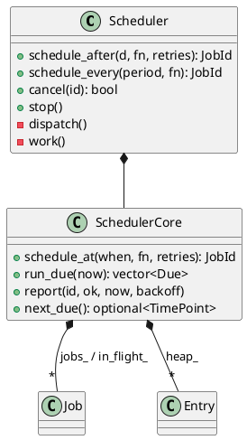

# 12. UML and Communicating Design

**Time:** ~1.5 hours   **Prerequisites:** 09, 11

## 1. In plain words

A design that lives only in your head cannot be reviewed, criticised or improved by anyone
else. In an interview it cannot even be graded. Communicating design is a separate skill from
having one: choosing what to show, drawing it so it reads in seconds, and explaining the
choices before someone asks.

UML (Unified Modeling Language) is a standard set of diagram notations. The full standard is
huge; nobody uses all of it. Three diagrams cover almost everything a C++ engineer draws:
the **class diagram** (what the pieces are and who owns whom), the **sequence diagram**
(who calls whom, in what order, for one request), and the **state diagram** (the states an
object moves through). Learn those three well enough to draw them in ASCII on a shared
editor, and as PlantUML text that turns into a picture in a design document.

Then learn two formats: a 10-minute spoken design presentation, and a one-to-two page design
document with a trade-off table. Those are what senior engineers produce every week.

## 2. The real thing

### 2.1 Class diagrams: only the notation you need

```
 +----------------------+
 | ClassName            |     name
 +----------------------+
 | - field: Type        |     fields (often omitted on whiteboards)
 +----------------------+     visibility: + public, - private, # protected
 | + method(arg): Ret   |     operations: the important ones only
 +----------------------+

 A <>------> B     composition: A owns B, B dies with A        (C++: B member or unique_ptr<B>)
 A <> - - -> B     aggregation: A refers to B it does not own   (C++: B& / B* / weak_ptr)
 A --------> B     association / uses: A calls or depends on B
 A ------|>  B     generalisation: A inherits from B             (C++: class A : public B)
 A - - - |>  B     realisation: A implements interface B        (C++: B has pure virtuals)
 A - - - - > B     dependency: A uses B transiently (parameter, local)

 Multiplicity at the ends:  1   0..1   *   1..*
```

Rules for a readable class diagram:

- **Ownership first.** For a C++ audience, composition versus reference is the most useful
  information on the page. Draw every `unique_ptr` and value member as composition, every
  reference or observer pointer as aggregation/association.
- **Fewer than about ten boxes.** If you need more, draw two diagrams at two levels.
- **Interfaces marked.** Write `<<interface>>` above the name, or name it with the role
  (`Storage`, `Clock`) and draw realisations to it.
- **Leave out getters, setters, constructors** and standard library types. Show
  `vector<Level>` as a composition with multiplicity `*`, not as a box for `vector`.

Example (the KV service from Module 09):

```
                         +------------------+
                         | <<interface>>    |
                         | Storage          |
                         +------------------+
                         | get/put/erase    |
                         +------------------+
                                  ^
                                  | (realises)
 +-------------+         +--------+--------+       +---------------+
 | KvService   |         | MemoryStorage   |       | <<interface>> |
 | get/set/del |         +-----------------+       | Logger        |
 +-------------+                                   +---------------+
    |     |                                                ^
    |     +-- holds Logger& (not owned) -------------------+
    +-------- holds Storage& (not owned) ---> Storage (above)
```

The same diagram as PlantUML text (paste into any PlantUML renderer or the VS Code PlantUML
extension):



PlantUML arrows to remember: `<|--` inheritance, `<|..` implements, `*--` composition,
`o--` aggregation, `-->` association, `..>` dependency.

### 2.2 Sequence diagrams: one request, in order

Use one when the *order* of calls matters: a request through the layers, a handshake, a
shutdown. Time flows down; each column is an object; solid arrows are calls, dashed are
returns.

ASCII, for `SET key value` in tcpkv:

```
 Client     Connection     Parser       KvService      Storage
   |  "SET a 5\nhello\n"     |              |              |
   |---------->|             |              |              |
   |           | feed(bytes) |              |              |
   |           |------------>|              |              |
   |           |  Request{Set}              |              |
   |           |<- - - - - - |              |              |
   |           | set("a","hello")           |              |
   |           |--------------------------->|              |
   |           |             |              | put("a",...) |
   |           |             |              |------------->|
   |           |             |              |<- - - - - - -|
   |           |  Result ok  |              |              |
   |           |<- - - - - - - - - - - - - -|              |
   |  "+OK\n"  |             |              |              |
   |<----------|             |              |              |
```

PlantUML:



Add `alt`/`else` boxes for error paths and `loop` for repetition, but keep the happy path
readable first; draw the error path as a second diagram if it is complicated.

### 2.3 State diagrams

For anything with a lifecycle: connections, loan applications, orders, jobs.

```
          Submit             StartReview              Approve              Disburse
 [Draft] -------> [Submitted] ----------> [UnderReview] -------> [Approved] -------> [Disbursed]
    |                 |                     |      |                 |
    |                 |                     |      +---Reject---> [Rejected]
    |                 |                     |                        |
    +-----------------+--------Cancel-------+------------------------+-----> [Cancelled]

 Guard on Approve: [FOIR <= 50% and approver != maker]
```

PlantUML:



Notation: `event [guard] / action` on each arrow. A state diagram is also the best test
plan you will ever get: one test per arrow, one test per guard, and one test per (state,
event) pair that is *not* drawn, which must be refused.

### 2.4 Other diagrams worth knowing by name

- **Component / box-and-arrow diagram:** layers and libraries (Module 09's architecture
  pictures). Not strict UML; the most common diagram in real design documents.
- **Deployment diagram:** which process runs on which machine, with which ports. Useful for
  the loan server: app servers, database nodes, load balancer.
- **Activity diagram:** a flowchart with parallel branches. Rarely worth it; a numbered list
  usually reads better.

The C4 model (context, containers, components, code) is a popular convention for drawing
software architecture at four zoom levels; it is worth recognising the name.

### 2.5 Presenting a design in 10 minutes

The structure that works in interviews and design reviews:

| Minute | Content |
|---|---|
| 0 to 1 | **Problem and requirements.** One sentence of what, the 3-5 functional requirements, the numbers (scale, latency), what is out of scope. |
| 1 to 3 | **The big picture.** One diagram. Name each box and say its single responsibility. |
| 3 to 6 | **The core.** The central data structure or flow. A sequence diagram for the main request, or the class diagram of the core. Show the one piece of code that matters. |
| 6 to 8 | **Decisions and trade-offs.** Two or three decisions, each with the alternative you rejected and why. The trade-off table. |
| 8 to 9 | **Failure and scale.** What happens when X fails; what breaks first at 10x and what you would do. |
| 9 to 10 | **Open questions and next steps.** What you would build next, what you need decided. |

Speaking rules:
- **Lead with the answer.** "It is a list plus a hash map, sharded by key" first, then why.
- **Point at the diagram** while talking; refer to boxes by the names written on them.
- **Name trade-offs before you are asked.** "This makes reads O(depth); I accepted that
  because transactions are rarely more than two deep." That sentence is the senior signal.
- **Stop for questions** at the end of each section instead of racing to the end.
- **Do not defend every choice to the death.** "Good point; with that requirement I would
  switch to X" is the right answer when the requirement changes.

### 2.6 Design document template

One to two pages for a component, up to about six for a system. Copy this skeleton:

```markdown
# <Component name>: design

Author: <name>   Reviewers: <names>   Status: draft / in review / accepted   Date: <yyyy-mm-dd>

## 1. Context
Why this exists. The problem in two or three sentences. Links to tickets.

## 2. Goals and non-goals
Goals: numbered, testable ("p99 GET latency under 1 ms at 50k req/s on one node").
Non-goals: what this deliberately does not do, so reviewers do not ask.

## 3. Design
3.1 Overview diagram (component or class).
3.2 Main flow (sequence diagram for the primary request).
3.3 Data model / key data structures.
3.4 Interfaces (public API, wire format, config keys).
3.5 Concurrency and ownership (threads, locks, who owns what).
3.6 Failure handling (what fails, what the system does, what the user sees).

## 4. Alternatives considered
For each: one paragraph and why it was not chosen. Include a trade-off table.

## 5. Testing and rollout
Unit, integration, load tests. Rollout plan: flag, shadow, percentage, rollback.

## 6. Observability
Metrics, logs, alerts that tell you it is working.

## 7. Open questions
Numbered, each with an owner.
```

Writing rules: state numbers with units and their source ("typical", "measured on staging").
Write decisions as sentences ("We use an undo log because..."), not as bullet fragments. Put
the trade-off table where the decision is made, not in an appendix.

### 2.7 Trade-off tables

A trade-off table compares options against criteria that matter *for this problem*. It is
the fastest way to show you considered alternatives.

| Criterion | Option A: one mutex | Option B: 16 striped mutexes | Option C: lock-free map |
|---|---|---|---|
| Throughput under contention | low | high | highest |
| Code complexity | trivial | small | high (memory reclamation) |
| Correctness risk | very low | low (no cross-stripe ops) | high |
| Cross-key operations (KEYS, snapshot) | easy | must lock all stripes in order | hard |
| Fits our load (about 2k req/s) | yes | yes | overkill |
| **Decision** | | **chosen**: headroom at small cost | |

Rules:
- **Criteria first**, from the requirements, before you fill cells. Otherwise you choose
  criteria that favour the option you already like.
- **Words or measured numbers** in the cells. "Fast" is not a measurement; "120 ns/op on
  the staging box, `bench/lock_bench`" is.
- **Include the option you rejected that a reviewer will suggest.** It pre-empts the question.
- **State the decision and the main reason** in one line under the table.

Common trade-off axes for C++ design: runtime vs compile-time polymorphism (Module 08),
latency vs throughput, memory vs CPU, consistency vs availability, simplicity vs
flexibility, build-time cost vs run-time cost.

## 3. Code

This module has no code file. Its "code" is the PlantUML above and the diagrams in the
headers of the Module 11 files: open `code/m11_workflow_engine.cpp`,
`code/m11_job_scheduler.cpp` and `code/m11_rate_limiter.cpp` and compare their ASCII class
diagrams to the code beneath. Exercise 2 asks you to turn one into PlantUML.

A compact PlantUML class diagram for the job scheduler, for reference:



## 4. Under the hood (senior-level)

**How diagram notation maps onto C++ object layout.** Composition by value means the part's
bytes are inside the whole (`sizeof(ParkingLot)` includes the `std::vector` header, and the
vector's heap block holds the `Level`s). Composition by `unique_ptr` means 8 bytes inside and
a separate heap block with its own lifetime bound to the owner. Aggregation by reference
means 8 bytes and *no* lifetime relation, so the diagram must say who does own the target.
Generalisation means the derived object starts with its base subobject (and a vptr if the
base is polymorphic). A reader who knows this can estimate memory and cache behaviour from
a class diagram, which is why ownership arrows matter more to C++ reviewers than to Java
reviewers.

**Dependency arrows and the build.** Each "uses" arrow between components becomes an
`#include` and a link dependency. A cycle on the diagram becomes either a header cycle
(fixed with forward declarations) or a static-library cycle (needing `--start-group`). Draw
the component diagram before the CMake file and the two should match.

**Sequence diagrams and threads.** A plain sequence diagram assumes one thread. When a call
crosses threads (enqueue to a pool, condition variable notify), draw it as an asynchronous
message (open arrowhead, `->>` in PlantUML) and show the queue as its own participant. Many
concurrency bugs become visible the moment you draw where each lifeline's thread changes:
a callback arriving on a thread that does not hold the lock you assumed.

**PlantUML itself** is a Java program that parses the text and lays out the graph with
Graphviz (for class and component diagrams) or its own layout engine (for sequence
diagrams). Because the source is text, diagrams can live in the repository next to the code,
be reviewed in pull requests, and be regenerated in CI, unlike a picture pasted into a wiki.
Mermaid is a JavaScript alternative with similar syntax that GitHub renders natively in
Markdown files.

## 5. In production

**The diagram that lied.** An architecture diagram on the wiki showed the app server talking
only to the database; in reality three handlers also called a credit-bureau service directly
with a 30-second timeout. When the bureau slowed down, the worker pool exhausted and the
whole server stopped, and the on-call engineer lost an hour because the diagram did not
show the dependency. Keep diagrams as text in the repo, next to the code, and update them in
the same pull request as the change.

**Design reviews that stall.** A twelve-page design document with no decision stated up
front gets comments on fonts and naming. Put the decision and its trade-off table on page
one. Reviewers then argue about the decision, which is what you need.

**Sequence diagrams for incidents.** In a post-incident review, a sequence diagram of what
actually happened (with timestamps from logs on each arrow) is the clearest way to show a
race or a timeout chain. It is also the format that convinces a manager to fund the fix.

**Explaining your work in interviews.** For the resume line on the loan-origination server,
prepare one component diagram (Module 09 section 2.10), one sequence diagram for "submit an
application", and the state diagram for the application lifecycle. Three pictures, ten
minutes, and you can answer most follow-ups by pointing.

## 6. Try it

1. **(easy)** Draw the class diagram of `code/m11_parking_lot.cpp` in ASCII with correct
   composition and association arrows. Done when every `unique_ptr`/value member is
   composition and every reference is aggregation.
2. **(easy)** Convert the ASCII class diagram at the top of `code/m11_rate_limiter.cpp` to
   PlantUML and render it. Done when the rendered picture matches the code.
3. **(medium)** Draw a sequence diagram for tcpkv shutdown (spec section 4.4) including the
   signal handler, the wake pipe, the acceptor, the thread pool and one busy worker. Mark the
   asynchronous arrows. Done when every step in the spec appears as an arrow.
4. **(medium)** Write a trade-off table for "where should loan eligibility rules live:
   C++ service, PL/pgSQL procedure, or a rules-engine product" with at least six criteria.
   Done when it ends with a one-line decision and reason.
5. **(hard)** Write a two-page design document using the template for the LRU cache with TTL
   (Module 11) as if it were going into the loan server as the master-data cache. Present
   it aloud in 10 minutes with a timer, recording yourself. Done when the recording is under
   10 minutes and covers every row of the presentation table.

## 7. Interview questions

**Q: Which UML diagrams do you actually use?**
A: Class diagrams for structure and ownership, sequence diagrams for the order of calls in
one request or protocol, and state diagrams for lifecycles. Plus informal component diagrams
for architecture. The rest of UML rarely pays for itself.

**Q: What is the difference between composition and aggregation, in C++ terms?**
A: Composition means the whole owns the part and the part's lifetime ends with the whole: a
value member or a `unique_ptr`. Aggregation means the whole refers to a part it does not own:
a reference, raw observer pointer or `weak_ptr`, with someone else responsible for keeping it
alive.

**Q: How would you present a design in ten minutes?**
A: Problem and requirements in a minute, one big-picture diagram, the core flow or data
structure, two or three decisions with rejected alternatives and a trade-off table, failure
and scale behaviour, then open questions. Lead with the answer and name trade-offs before
being asked.

**Q: What goes into a design document?**
A: Context, goals and non-goals, the design (diagram, main flow, data model, interfaces,
concurrency, failure handling), alternatives considered with a trade-off table, testing and
rollout, observability, and open questions with owners. Decisions stated as sentences near
the top.

**Q: How do you build a trade-off table that is not biased?**
A: Choose criteria from the requirements before filling in options, include the option a
reviewer is likely to suggest, use measured numbers or plain words rather than adjectives,
and state the decision and its main reason under the table.

**Q: Why keep diagrams as text?**
A: Text diagrams (PlantUML, Mermaid) live in the repository, are reviewed and versioned with
the code, and can be updated in the same change that alters the design. Pictures on a wiki
drift out of date and mislead people during incidents.

## 8. Recap

- Three diagrams: class (structure and ownership), sequence (order of calls), state (lifecycle).
- Composition = value member or `unique_ptr`; aggregation = reference or observer pointer.
- Fewer than ten boxes per diagram; ownership arrows matter most to C++ readers.
- PlantUML arrows: `<|--`, `<|..`, `*--`, `o--`, `-->`, `..>`; async messages `->>`.
- A state diagram is a test plan: one test per arrow, guard and missing arrow.
- Ten-minute talk: requirements, picture, core, trade-offs, failure and scale, open questions.
- Design doc: context, goals, design, alternatives with a table, testing, observability, questions.
- Trade-off tables: criteria first, honest cells, the rejected option included, one-line decision.
- Keep diagrams as text in the repo and change them with the code.

